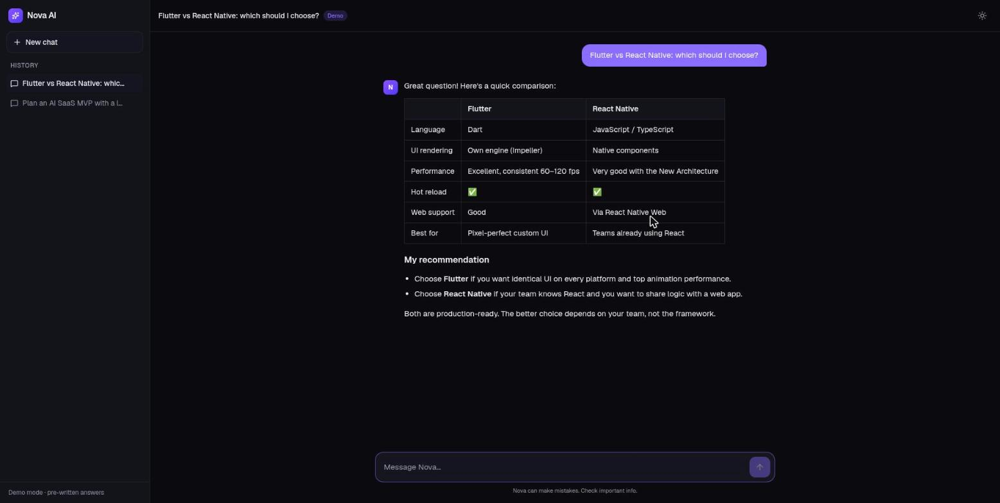
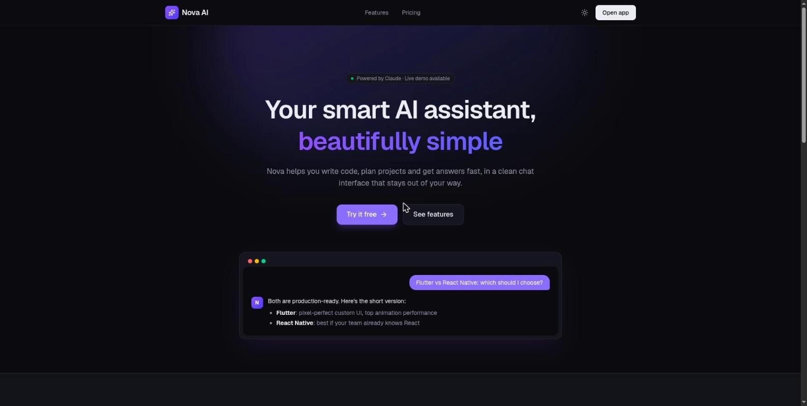
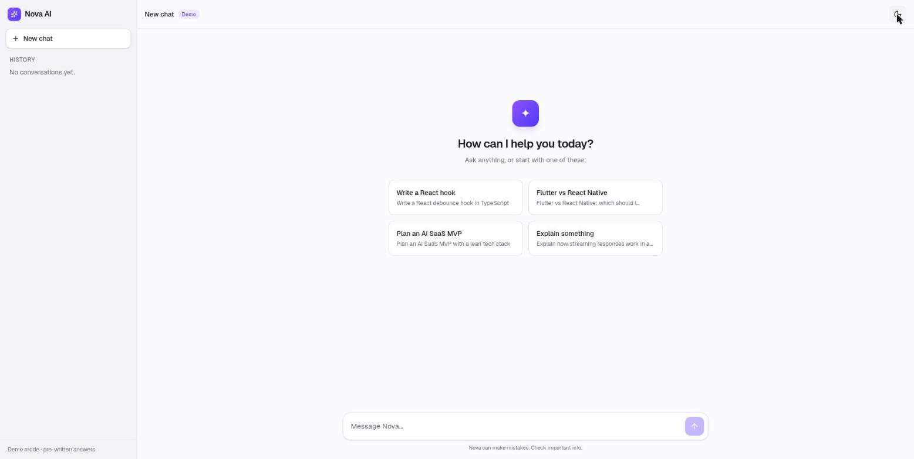

# Nova AI: AI Chat SaaS

**🔗 Live demo: [nova-ai-chat-orcin.vercel.app](https://nova-ai-chat-orcin.vercel.app)**

A modern AI chat web app built with **Next.js, TypeScript and Tailwind CSS**. It streams answers in real time and scrolls with them as they arrive, saves your chat history, and has light and dark themes. A landing page with pricing is included.

It runs in **demo mode** out of the box: realistic pre-written answers are streamed token by token, so the live demo works without an API key and costs nothing. Add an Anthropic API key and Nova answers with **Claude** instead.



| Landing page | Light mode |
|---|---|
|  |  |

## Features

- **Real-time streaming**: answers appear word by word, and a stop button cancels the request on the server too.
- **Smart auto-scroll**: the chat follows the answer while it streams and pauses when the user scrolls up to read. A "jump to latest" button brings the user back down.
- **Markdown rendering**: headings, lists, tables (GFM) and code blocks with a copy button.
- **Chat history**: conversations are saved in `localStorage`. Saving is throttled during streaming and flushed on `pagehide`, so a partial answer survives a page reload.
- **Light / dark mode**: follows the system setting by default and remembers the user's choice. There is no flash on load.
- **Responsive**: on mobile the sidebar slides out, and the message box grows as you type.
- **Demo / live modes**: one environment variable switches between the mock stream and Claude.

## Tech stack

| Layer | Technology |
|---|---|
| Framework | Next.js 16 (App Router, Route Handlers) |
| Language | TypeScript (strict) |
| Styling | Tailwind CSS v4 with CSS-variable design tokens |
| AI | Anthropic SDK (`@anthropic-ai/sdk`), streaming |
| Markdown | `react-markdown` + `remark-gfm` |
| Icons | `lucide-react` |

## Getting started

```bash
git clone https://github.com/kinglant/nova-ai-chat.git
cd nova-ai-chat
npm install
npm run dev
```

Open <http://localhost:3000>.

### Live mode (optional)

```bash
cp .env.example .env.local
# then set ANTHROPIC_API_KEY=... in .env.local
```

## Project structure

```
src/
├── app/
│   ├── page.tsx              # Landing page (hero, features, pricing)
│   ├── chat/page.tsx         # Chat app route
│   └── api/chat/route.ts     # Streaming endpoint (Claude or demo)
├── components/
│   ├── chat/ChatApp.tsx      # Sidebar, messages, message box
│   ├── chat/Markdown.tsx     # Markdown + code blocks with copy
│   ├── Logo.tsx
│   └── ThemeToggle.tsx
├── hooks/
│   └── useStickToBottom.ts   # Auto-scroll that respects the user's scrolling
└── lib/
    ├── chatStore.ts          # Conversation store (useSyncExternalStore + localStorage)
    ├── mock.ts               # Demo-mode answers and token streaming
    └── types.ts
```

## How the auto-scroll works

`useStickToBottom` keeps track of whether the user is near the bottom of the chat (within 80px). A `ResizeObserver` watches the message list. Streamed tokens make the list grow without adding new messages, so the observer is what lets the view follow the answer. It only scrolls while the user is "stuck" to the bottom, and scrolling up turns that off. A `MutationObserver` re-attaches the `ResizeObserver` whenever messages are added or removed.

## Deploy

The easiest option is Vercel: import the repository and, optionally, add `ANTHROPIC_API_KEY` as an environment variable. Without the key the deployment runs in demo mode.

---

Personal portfolio project.
